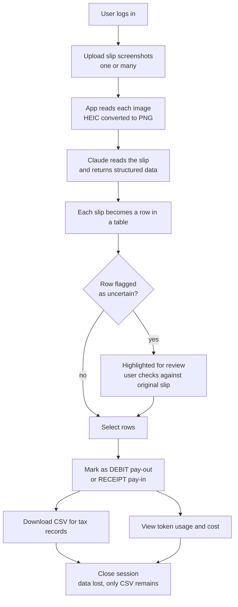

# Architecture

## What the app does

A user uploads screenshots of QR-payment confirmation slips. Claude (vision +
forced tool use) turns each into structured data. The user reviews the table,
classifies rows as pay-in or pay-out, and downloads a CSV for tax records.

## User flow

1. **Log in** with a username/password from Streamlit secrets.
2. **Upload** one or many slips (PNG, JPG, GIF, WebP, HEIC/HEIF).
3. **Prepare**: each image is base64-encoded; HEIC is converted to PNG first
   because Claude's vision API doesn't accept HEIC.
4. **Extract**: one Claude call per image, with the extraction tool forced via
   `tool_choice`, so the reply is always structured JSON.
5. **Table**: each slip becomes one row. Files already processed in this
   session are skipped (name + size + hash).
6. **Review**: `low` / `needs_review` rows are highlighted with a banner.
7. **Classify**: select rows, mark DEBIT (pay-out) or RECEIPT (pay-in).
8. **Export**: download the CSV; a panel shows tokens and estimated cost.
9. **Session ends**: refreshing or closing the tab discards everything.

## Modules

| Module | Responsibility | Knows about |
|---|---|---|
| `app.py` | Streamlit UI: login, upload, table, classification, download. The only UI/CLI layer. | everything below |
| `src/config.py` | Model ID, pricing label, `MAX_ACCOUNT_DIGITS` | nothing |
| `src/schema.py` | `PaymentRecord`, `EXTRACTION_TOOL` JSON schema, `build_record()` | config |
| `src/image_loader.py` | `find_images()`, `encode_image()` (HEIC → PNG, EXIF rotation) | Pillow |
| `src/extractor.py` | `extract_from_image()`: one Claude call → `(fields, usage)` | image_loader, config |
| `src/token_tracker.py` | `TokenTracker`; cost from Anthropic's live pricing page | config |
| `src/storage.py` | records → DataFrame → CSV (file or in-memory bytes) | schema |

Data flows one way: `image → encode_image → extract_from_image → build_record →
to_dataframe → CSV`.

## Design rules

- **`src/` is free of UI/CLI concerns.** No `print()`, `argparse`, `st.*`, or
  stdin. Functions take plain arguments and return values. A future backend
  (e.g. a LINE webhook, see [`LINE_INTEGRATION.md`](LINE_INTEGRATION.md)) calls
  the same functions the Streamlit app calls today.
- **The model's output is untrusted input.** `build_record()` defends at that
  boundary: missing/invalid date or amount forces `needs_review`; account
  numbers are cut to the last 4 digits.
- **Never store a full account number.** Hard constraint, enforced in code and
  covered by tests.
- **No bank data on the server's disk.** CSVs are built in memory for download.
  `sample_images/` and `output/` are gitignored, and a pre-commit hook blocks
  committing anything in them.
- **No hardcoded token prices.** They're parsed from the published pricing page
  and degrade to "N/A" when unreachable.
- **`storage.py` is the only module that knows about CSV**, so Phase 2 can swap
  it for Supabase without touching the rest.

## Data model

`PaymentRecord` (`src/schema.py`) maps ~1:1 onto the extraction tool's schema.
Not extracted by Claude:

- `source_filename` — set by the caller
- `shop_id` — forward-compat placeholder for multi-shop (stays `None` in Phase 1)
- `transaction_type` — `"DEBIT"` / `"RECEIPT"` / `None`, set by the user in the review UI

Payer fields describe who paid; recipient fields describe the shop's own
receiving account.

## Known limitations (Phase 1)

- Table is read-only — wrong values can be spotted but not edited in the app.
- No persistence; no duplicate detection (Phase 2).
- Single currency (THB).
- Shared plain-text credentials in secrets — fine for a few named people only.
