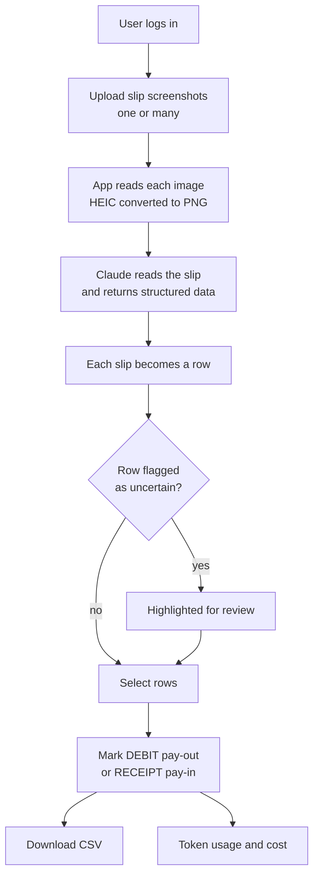
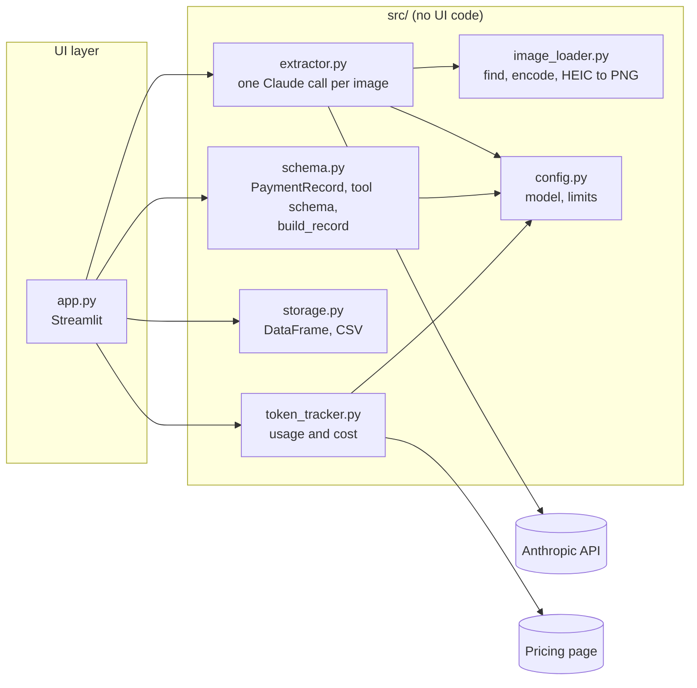
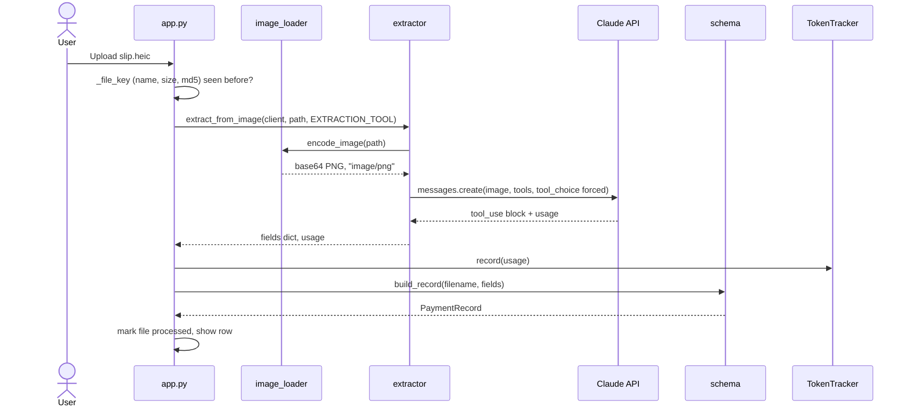
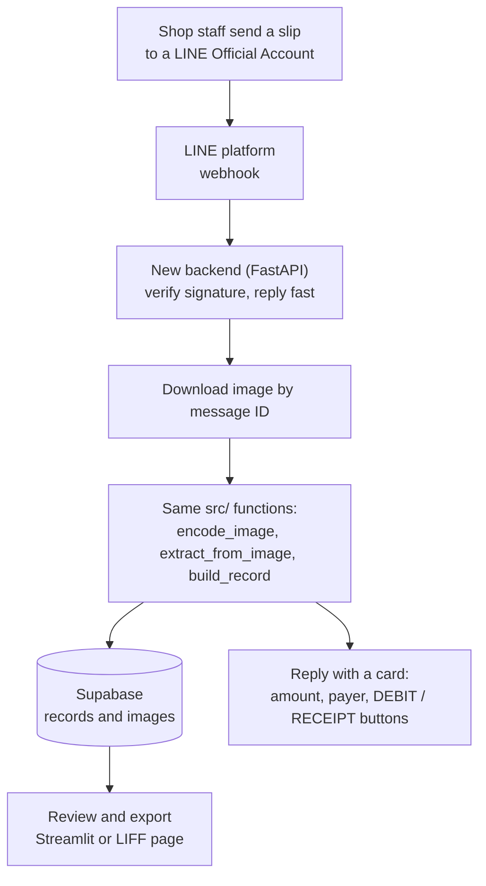

# QR Payment Ledger: code walkthrough

How the app works, file by file and in the order things happen. It is written for a developer who is learning Python and the Anthropic API.

Code shown is from this repository, trimmed where noted. Line numbers refer to `app.py` and will drift if the file changes. For the shorter overview see [`ARCHITECTURE.md`](ARCHITECTURE.md), and for tooling see [`DEVELOPMENT.md`](DEVELOPMENT.md).

**Contents**

1. [Overview](#1-overview)
2. [Architecture](#2-architecture)
3. [One upload, end to end](#3-one-upload-end-to-end)
4. [Code breakdown](#4-code-breakdown)
5. [Data model](#5-data-model)
6. [Safeguards](#6-safeguards)
7. [What comes next](#7-what-comes-next)

---

## 1. Overview

A Streamlit app that turns screenshots of Thai QR-payment slips into a reviewable table and a CSV for tax records. Claude's vision reads each slip, and a forced tool call makes the answer structured data instead of prose. This is Phase 1: nothing is saved between sessions.



1. **Log in** with a username and password from Streamlit secrets.
2. **Upload** PNG, JPG, GIF, WebP or HEIC files. Files already processed in the session are skipped.
3. **Extract.** One Claude call per image, with the extraction tool forced, returns the fields and the token usage.
4. **Review.** Rows rated `low` or `needs_review` are highlighted and listed in a banner.
5. **Classify.** Select rows and mark them DEBIT or RECEIPT. Claude never sets this, so the Type column starts empty.
6. **Export.** The CSV is built in memory and downloaded. A panel shows calls, tokens and an estimated cost.

---

## 2. Architecture

One rule shapes the layout: `src/` takes plain arguments and returns values, with no `print`, `argparse` or `st.*`. Only `app.py` touches the UI. A future backend can call the same functions.



| Module | Job |
|---|---|
| `app.py` | Login, upload loop, table, classify buttons, download |
| `src/schema.py` | `PaymentRecord`, the extraction tool's JSON schema, `build_record()` |
| `src/image_loader.py` | Find images, base64-encode, convert HEIC |
| `src/extractor.py` | `extract_from_image()`, the vision and tool-use call |
| `src/token_tracker.py` | Totals tokens, estimates cost from the live pricing page |
| `src/storage.py` | Records to DataFrame to CSV (file or bytes) |
| `src/config.py` | Model ID, pricing label, account-digit limit |

---

## 3. One upload, end to end

What happens for a single file, in call order.



---

## 4. Code breakdown

### 4.1 How the app runs

**There is no `main()`.** Streamlit runs `app.py` from the first line to the last, every time anything happens: the page first loads, a file is uploaded, a row is ticked, a button is clicked, or the code calls `st.rerun()`. Anything that must survive between runs has to be kept in `st.session_state`.

The order, top to bottom:

| Lines | What runs |
|---|---|
| 1 to 26 | **Imports and `load_dotenv()`.** Importing `src.*` runs those modules' top-level code once, such as registering the HEIC opener in `image_loader`. `load_dotenv()` copies `ANTHROPIC_API_KEY` from `.env` into the environment. |
| 28 to 86 | **Definitions only.** The constant `FLAGGED_CONFIDENCE_LEVELS` and the functions `_file_key`, `_get_credentials` and `_require_login`. Defining a function does not run it. |
| 89 | **`st.set_page_config(...)`** sets the tab title and wide layout. It has to be the first Streamlit call on the page. |
| 90 | **`_require_login()`, the gate.** Logged in, it returns at once. Not logged in, it draws the login form and calls `st.stop()` (line 86), which ends the run. Nothing below line 90 runs for a logged-out user. |
| 92 to 96 | **Sidebar.** Shows "Logged in as ..." and a Log out button. |
| 98 to 102 | **Page title and caption.** |
| 105 to 107 | **Session state set-up.** `setdefault` creates `records`, `processed_file_keys` and `tracker` the first time only. Later runs leave them alone. |
| 109 to 116 | **Create the Anthropic client.** If the API key is missing, show an error and `st.stop()`. |
| 118 to 122 | **`st.file_uploader(...)`.** Returns the files currently held by the widget, on every run, including files uploaded earlier. |
| 124 to 145 | **Process new files.** Only files whose key is not in `processed_file_keys` go through extraction. This is the slow part, with one Claude call per file. |
| 147 to 198 | **Table section.** If there are records: build the DataFrame, show the review banner and table, the DEBIT and RECEIPT buttons, and the download button. Otherwise show "Upload one or more slip images to get started." |
| 200 to 210 | **Token usage panel.** Always runs. |

**Example: clicking "Mark selected as RECEIPT".** The click starts a new run from line 1. Login passes, the state already exists, and no new files are found, so extraction is skipped. At line 186 `st.button(...)` returns `True` for this run only, so the selected records get `transaction_type = "RECEIPT"`, and `st.rerun()` immediately starts one more run. That run redraws the table with the Type column filled in.

### 4.2 Login gate

`app.py`, lines 37 to 90 (trimmed):

```python
def _get_credentials():
    try:
        return dict(st.secrets.get("app_credentials", {}))
    except StreamlitSecretNotFoundError:
        return {}                      # no secrets.toml yet: show a setup message, not a traceback

def _require_login():
    if st.session_state.get("authenticated"):
        return                         # already in, carry on with the page

    credentials = _get_credentials()
    if not credentials:
        st.error("No login credentials configured. ...")
        st.stop()

    with st.form("login_form"):
        username = st.text_input("Username")
        password = st.text_input("Password", type="password")
        submitted = st.form_submit_button("Log in")

    if submitted:
        expected = credentials.get(username)
        if expected is not None and hmac.compare_digest(password, expected):
            st.session_state.authenticated = True
            st.session_state.username = username
            st.rerun()
        else:
            st.error("Incorrect username or password.")

    st.stop()                          # logged-out users never reach the rest of app.py
```

| Situation | What happens |
|---|---|
| Already logged in | Returns immediately. The page continues. |
| No credentials configured | Red setup message, then the script stops. |
| First visit | Form is drawn. `submitted` is false, so it falls to the final `st.stop()`. |
| Wrong password | "Incorrect username or password." The script stops. |
| Correct password | Sets `authenticated` and `username`, then `st.rerun()`. The next run passes the first check. |

The form batches the two text boxes, so typing does not trigger a rerun until the button is pressed. `hmac.compare_digest` compares in constant time. Passwords are plain text in secrets, which suits a few named people and is the reason to move to real accounts later.

### 4.3 Session state

`app.py`, lines 31 to 35 and 105 to 107:

```python
st.session_state.setdefault("records", [])
st.session_state.setdefault("processed_file_keys", set())
st.session_state.setdefault("tracker", TokenTracker())

def _file_key(uploaded_file):
    digest = hashlib.md5(uploaded_file.getvalue()).hexdigest()
    return f"{uploaded_file.name}:{uploaded_file.size}:{digest}"
```

`st.session_state` is a dictionary that belongs to one browser session and survives reruns. Because the script restarts on every interaction, ordinary variables would be reset each time. Refreshing the page starts a new session, which is why Phase 1 loses its data on refresh.

| Key | Holds | Used by |
|---|---|---|
| `authenticated`, `username` | Login result | Login gate, sidebar |
| `records` | List of `PaymentRecord`. **The source of truth.** | Upload loop adds, table reads, buttons edit |
| `processed_file_keys` | Set of file keys already extracted | Stops the same file being sent to Claude twice |
| `tracker` | One `TokenTracker` | Upload loop records, usage panel reads |
| `ledger_table` | Row selection of the table (set by the widget's `key`) | Classify buttons |

The file key joins name, size and an md5 hash of the bytes. Renaming a file does not fool it, and two different files with the same name do not collide. md5 is used only as a fingerprint here, not for security.

### 4.4 Upload loop

`app.py`, lines 124 to 145 (trimmed):

```python
if uploaded_files:
    new_files = [f for f in uploaded_files if _file_key(f) not in st.session_state.processed_file_keys]
    if new_files:
        progress = st.progress(0.0, text="Extracting payment details...")
        for i, uploaded_file in enumerate(new_files):
            suffix = Path(uploaded_file.name).suffix
            with tempfile.NamedTemporaryFile(suffix=suffix, delete=False) as tmp:
                tmp.write(uploaded_file.getvalue())
                tmp_path = Path(tmp.name)
            try:
                fields, usage = extract_from_image(client, tmp_path, EXTRACTION_TOOL)
                st.session_state.tracker.record(usage)
                st.session_state.records.append(build_record(uploaded_file.name, fields))
                st.session_state.processed_file_keys.add(_file_key(uploaded_file))
            except Exception as exc:
                st.error(f"Failed to process {uploaded_file.name}: {exc}")
            finally:
                tmp_path.unlink(missing_ok=True)
            progress.progress((i + 1) / len(new_files), text=f"Processed {uploaded_file.name}")
        progress.empty()
```

1. **Filter.** Keep only files whose key has not been seen.
2. **Temp file.** The browser upload is bytes in memory, but `encode_image` takes a file path, so each file is written to a temporary file first.
3. **Extract.** One Claude call returns the fields and the token usage.
4. **Record.** Usage goes to the tracker, the fields become a `PaymentRecord`, and the file is marked processed. Marking happens only after success, so a failed file can be uploaded again.
5. **Failure.** Any exception shows a red message for that file. The loop moves on to the next file.
6. **Cleanup.** `finally` deletes the temp file whether it worked or not.

Files are processed one after another, not in parallel. The progress bar moves after each one.

### 4.5 `extract_from_image`

`src/extractor.py`:

```python
def extract_from_image(client, path, tool_schema):
    base64_data, media_type = encode_image(path)

    response = client.messages.create(
        model=MODEL,
        max_tokens=1024,
        tools=[tool_schema],
        tool_choice={"type": "tool", "name": tool_schema["name"]},
        messages=[{"role": "user", "content": [
            {"type": "image", "source": {"type": "base64",
                                         "media_type": media_type, "data": base64_data}},
            {"type": "text", "text": "Extract the payment details from this slip."},
        ]}],
    )

    for block in response.content:
        if block.type == "tool_use":
            return block.input, response.usage

    if response.stop_reason == "max_tokens":
        raise ValueError("Response was cut off (max_tokens) before the extraction finished")
    raise ValueError("Claude response contained no tool_use block")
```

| Argument | What it does here |
|---|---|
| `model` | From `config.MODEL`, currently `claude-sonnet-5-5`. |
| `max_tokens=1024` | Upper limit on the reply. A tool call with about a dozen fields fits easily. |
| `tools=[tool_schema]` | The one tool Claude is allowed to use: `extract_payment_record`. |
| `tool_choice` | Forces that tool to be called. Claude cannot answer in prose. |
| image block | The slip as base64 with its media type. |
| text block | A short instruction. The detailed guidance lives in the tool schema's field descriptions. |

1. Encode the image (HEIC becomes PNG).
2. Send one request containing the image, the instruction and the tool.
3. Walk `response.content` to find the `tool_use` block. Its `input` is a dict shaped like the tool's JSON schema.
4. Return `(fields, usage)`. `usage` carries `input_tokens` and `output_tokens` for the tracker.
5. If there is no tool block, raise an error. A response cut off by `max_tokens` gets its own message. The upload loop catches the error and shows it for that file.

The function only talks to the API. It does not create records or track tokens, which keeps it easy to swap for another extractor later.

### 4.6 Tool schema

`src/schema.py`, `EXTRACTION_TOOL` (trimmed):

```python
EXTRACTION_TOOL = {
    "name": "extract_payment_record",
    "description": "Extract structured payment data from a QR payment confirmation slip ...",
    "input_schema": {
        "type": "object",
        "properties": {
            "transaction_date": {"type": "string", "description": "... ISO 8601 format, e.g. \"2026-08-14\"."},
            "transaction_time": {"type": ["string", "null"], "description": "... Null if not visible."},
            "amount":           {"type": "number", "description": "Payment amount as a number, e.g. 250.00."},
            "payer_account_last_digits": {"type": ["string", "null"],
                "description": "Last few digits only ... Never the full number."},
            "extraction_confidence": {"type": "string", "enum": ["high", "low", "needs_review"], ...},
            # ... payer, recipient, reference_number, notes
        },
        "required": ["transaction_date", "amount", "currency", "extraction_confidence"],
    },
}
```

This is a JSON Schema describing what the tool accepts. Because the call is forced, Claude fills it in from what it sees on the slip.

- **Descriptions are the instructions.** The model reads each field's description to decide what goes where, for example "payer, not the shop's own account name".
- **Nullable fields.** `["string", "null"]` lets Claude say "not on this slip" instead of inventing a value.
- **Required fields.** Only date, amount, currency and confidence must be present. Everything else may be missing, which is why `build_record` reads defensively.

The schema mirrors `PaymentRecord` except for `source_filename`, `shop_id` and `transaction_type`, which Claude cannot know.

### 4.7 Image prep

`src/image_loader.py` (trimmed):

```python
pillow_heif.register_heif_opener()      # once, when the module is imported

HEIC_EXTENSIONS = {".heic", ".heif"}
MEDIA_TYPES = {".png": "image/png", ".jpg": "image/jpeg", ".jpeg": "image/jpeg",
               ".gif": "image/gif", ".webp": "image/webp"}
SUPPORTED_EXTENSIONS = set(MEDIA_TYPES) | HEIC_EXTENSIONS

def encode_image(path):
    suffix = Path(path).suffix.lower()

    if suffix in HEIC_EXTENSIONS:
        image = ImageOps.exif_transpose(Image.open(path))
        buffer = io.BytesIO()
        image.save(buffer, format="PNG")
        return base64.b64encode(buffer.getvalue()).decode("utf-8"), "image/png"

    if suffix not in MEDIA_TYPES:
        raise ValueError(f"Unsupported image type {suffix!r}: ...")
    return base64.b64encode(path.read_bytes()).decode("utf-8"), MEDIA_TYPES[suffix]
```

| Input | What `encode_image` does | Media type sent |
|---|---|---|
| PNG, JPG, GIF, WebP | Reads the bytes as they are and base64-encodes them. | From the extension |
| HEIC, HEIF | Opens with Pillow, applies the phone's rotation, re-saves as PNG in memory, then encodes. | `image/png` |
| Anything else | Raises `ValueError` naming the supported types. | none |

The API accepts only JPEG, PNG, GIF and WebP, so iPhone HEIC photos have to be converted first. Registering the HEIC opener once lets `Image.open` read HEIC like any other format. Base64 turns the binary image into text that can travel inside the JSON request.

`app.py` uses `SUPPORTED_EXTENSIONS` to decide which file types the uploader accepts. `find_images(folder)` lists images in a folder, matching extensions in any letter case. The app does not call it today. It is kept for a folder-based or backend path.

### 4.8 `build_record`

`src/schema.py` (trimmed):

```python
def _last_digits(value):
    if not value: return None, False
    digits = re.sub(r"\D", "", str(value))              # keep digits only
    if not digits: return None, False
    return digits[-MAX_ACCOUNT_DIGITS:], len(digits) > MAX_ACCOUNT_DIGITS

def build_record(filename, fields):
    notes = [fields["notes"]] if fields.get("notes") else []
    confidence = fields.get("extraction_confidence", "needs_review")

    try:
        amount = float(fields.get("amount"))
    except (TypeError, ValueError):
        amount = None
    if amount is None or not fields.get("transaction_date"):
        confidence = "needs_review"
        notes.append("Missing or unreadable date/amount.")

    payer_digits, payer_cut = _last_digits(fields.get("payer_account_last_digits"))
    recipient_digits, recipient_cut = _last_digits(fields.get("recipient_account_last_digits"))
    if payer_cut or recipient_cut:
        notes.append(f"Account number truncated to last {MAX_ACCOUNT_DIGITS} digits.")

    return PaymentRecord(source_filename=filename, amount=amount, ...,
                         extraction_confidence=confidence, notes=" ".join(notes) or None)
```

The model's output is untrusted input, so this function is the checkpoint between the API and the rest of the app. It runs once per file, right after extraction.

| Input from Claude | Result in the record |
|---|---|
| `amount: "250.00"` or `250` | `250.0` (converted with `float`) |
| `amount` missing or `"abc"` | `None`, confidence forced to `needs_review`, note added |
| No `transaction_date` | Same: forced to `needs_review` |
| `payer_account_last_digits: "xxx-x-x1234-5678"` | `"5678"`, plus a note that it was truncated |
| `recipient_account_last_digits: "XXX-X-X5678-X"` | `"5678"`, no note (already 4 digits) |
| `extraction_confidence` missing | `needs_review` |
| `currency` missing | `"THB"` |
| (not provided by Claude) | `transaction_type` stays `None`, `shop_id` stays `None` |

Six tests in `tests/test_schema.py` cover these cases without calling the API.

### 4.9 Table and buttons

`app.py`, lines 147 to 198 (trimmed):

```python
if st.session_state.records:
    df = to_dataframe(st.session_state.records)               # rebuilt on every run

    flagged = df["extraction_confidence"].isin(FLAGGED_CONFIDENCE_LEVELS)
    if flagged.any():
        st.warning(f"{flagged.sum()} record(s) need review before exporting: ...")

    selection = st.dataframe(
        df.style.apply(_highlight_flagged, axis=1),            # yellow rows for flagged ones
        on_select="rerun", selection_mode="multi-row", key="ledger_table",
    )
    selected_rows = selection.selection.rows                   # positions, e.g. [0, 2]

    if st.button("Mark selected as DEBIT", disabled=not selected_rows):
        for row in selected_rows:
            st.session_state.records[row].transaction_type = "DEBIT"
        st.rerun()
```

1. **Derive the table.** The DataFrame is built fresh from `records` on every run. The records list is the truth, and the table is only a view of it.
2. **Flag.** A boolean mask picks rows rated `low` or `needs_review`. They get a banner naming the files and a yellow background.
3. **Select.** `on_select="rerun"` reruns the script whenever the user ticks a row. `selection.selection.rows` is a list of row positions.
4. **Classify.** Row positions match positions in `records` because the DataFrame was built in that order. The button sets `transaction_type` on each selected record, then `st.rerun()` redraws the table.

The buttons are disabled until something is selected. The caption above them changes between "N row(s) selected" and a hint to select rows first. The table is read-only today, so a wrong value can be spotted but not corrected here.

### 4.10 CSV and tokens

`src/storage.py` and `src/token_tracker.py` (trimmed):

```python
# storage.py
def to_dataframe(records):
    columns = [field.name for field in fields(PaymentRecord)]    # column order = dataclass order
    return pd.DataFrame([asdict(r) for r in records], columns=columns)

def to_csv_bytes(df):
    return df.to_csv(index=False).encode("utf-8-sig")             # BOM so Excel shows Thai text

# token_tracker.py
def record(self, usage):
    self.call_count += 1
    self.total_input_tokens += usage.input_tokens
    self.total_output_tokens += usage.output_tokens
```

**CSV**

- `to_dataframe` turns records into a table with one column per `PaymentRecord` field, in field order.
- `to_csv_bytes` builds the file in memory. `st.download_button` hands those bytes to the browser, so nothing is written to the server's disk.
- `export_csv` writes to a path and is kept for local scripts. The app no longer uses it.

**Token usage and cost**

1. `summary()` asks `_published_rates_usd_per_mtok()` for the rates. The answer is cached after the first success.
2. `_fetch_pricing_page()` downloads the pricing page as markdown. A network error becomes a `PricingUnavailableError`.
3. `_parse_rates(page)` finds the standard pricing table, then the row for the configured model. A missing table or row also raises `PricingUnavailableError`.
4. On success, cost is tokens divided by 1,000,000, times the rate, for input and output. On failure, the cost is `None` and the reason is passed to the UI.

After each extraction `record()` adds that call's tokens to the totals. The parser reads the standard table and not the Batch table below it. The result is cached, so reruns do not hit the network. If the page cannot be reached or its layout changes, the token counts still show and the cost reads "N/A" with the reason.

### 4.11 Tests and hooks

Files: `tests/`, `.pre-commit-config.yaml`, `pyproject.toml`.

**What runs when you commit.** `git commit` triggers the pre-commit hooks, in this order. If any one fails, the commit is stopped. If a hook edits files, the commit is also stopped, so stage the changes and commit again.

| Order | Hook | What it does |
|---|---|---|
| 1 | `ruff-check --fix` | Lints the Python and fixes what it safely can: unused imports, import order, outdated syntax, simple style problems. |
| 2 | `ruff-format` | Formats the code, with a line length of 110. |
| 3 | File hygiene | `end-of-file-fixer` and `trailing-whitespace` tidy files, `check-added-large-files` blocks big files, `check-yaml` checks YAML syntax. |
| 4 | `no-slip-images` | Fails the commit if any staged file is inside `sample_images/` or `output/`, apart from `.gitkeep`. This stops real bank slips and exports being committed. |
| 5 | `pytest` | Runs the whole suite with `.venv/bin/python -m pytest -q` on every commit, whichever files changed. |

Hooks only run after `pre-commit install`, and the pytest hook uses the project's `.venv`. If you move the folder, rebuild the venv and run `pre-commit install` again. `git commit --no-verify` skips the hooks and should be an emergency option only.

**The tests.** There are 20, all offline. None needs an API key or a network connection. Images are generated on the fly and the pricing page download is replaced with a fake.

| File | Tests | What it protects |
|---|---|---|
| `test_schema.py` | 6 | `build_record`: normal case, truncation to 4 digits, masked digits kept, missing or unparseable amount forces `needs_review`, model notes preserved |
| `test_image_loader.py` | 4 | Finding images case-insensitively, PNG round trip, HEIC converted to PNG, unsupported type raises |
| `test_storage.py` | 4 | Column order matches the dataclass, empty input gives an empty frame, CSV file creation, BOM and Thai text in the CSV bytes |
| `test_token_tracker.py` | 6 | Token totals, cost maths, survives a pricing failure, parser reads the standard table and not the Batch one, "Sonnet 5" is not confused with "Sonnet 5.5", missing table raises |

```python
# tests/test_schema.py
def test_account_digits_truncated_to_last_four():
    record = build_record("slip.png", {**GOOD, "payer_account_last_digits": "xxx-x-x1234-5678"})
    assert record.payer_account_last_digits == "5678"
    assert "truncated" in record.notes

# tests/test_token_tracker.py
def test_summary_survives_pricing_failure(monkeypatch):
    monkeypatch.setattr(token_tracker, "_published_rates_usd_per_mtok", boom)   # boom raises PricingUnavailableError
    summary = tracker.summary()
    assert summary["estimated_cost_usd"] is None
    assert summary["total_input_tokens"] == 10      # token counts still reported
```

`monkeypatch` swaps a real function for a fake one for the length of a test. That is how the pricing download is avoided.

**Running them yourself**

```bash
pip install -r requirements-dev.txt     # ruff, pre-commit, pytest
pre-commit install                      # once per clone
pytest                                  # tests only
ruff check . && ruff format .           # lint and format
pre-commit run --all-files              # everything the commit hook runs
```

**Not covered yet:** `extract_from_image` (it needs a fake Anthropic client) and the Streamlit UI itself. Streamlit's `AppTest` can drive the UI in a test.

---

## 5. Data model

`PaymentRecord` maps almost one-to-one onto the extraction tool's schema. A few fields are set by something other than Claude.

| Field group | Fields | Set by |
|---|---|---|
| Transaction | `transaction_date`, `transaction_time`, `amount`, `currency` | Claude (date, amount, currency required) |
| Payer | `payer_name`, `payer_bank`, `payer_account_last_digits` | Claude, digits cut to 4 by code |
| Recipient (the shop) | `recipient_name`, `recipient_bank`, `recipient_account_last_digits` | Claude, often incomplete |
| Reference and quality | `reference_number`, `extraction_confidence`, `notes` | Claude, confidence overridden by code if data is missing |
| Source | `source_filename` | `app.py` |
| Future multi-shop | `shop_id` | Stays `None` until Phase 2 |
| Pay-in or pay-out | `transaction_type` | The user, in the review table |

---

## 6. Safeguards

| Risk | What the code does |
|---|---|
| Full account numbers stored | `build_record` keeps the last 4 digits only, and a test covers it. |
| Bad or missing extraction | Forced to `needs_review`, highlighted, and listed in a banner. |
| Bank data on the server's disk | The CSV is built in memory (UTF-8 with BOM, so Thai opens correctly in Excel). |
| Real slips committed to git | `.gitignore` plus a pre-commit hook that blocks anything in `sample_images/` or `output/`. |
| Duplicate spend | The file key stops a re-upload from calling the API again. |
| Code regressions | ruff, formatting and 20 offline tests run on every commit. |

**Known limits.** The table is read-only, so a wrong value can be spotted but not corrected in the app. Records disappear on refresh. Duplicate slips are not detected. Login is a shared secrets table, which suits a few named people only.

---

## 7. What comes next

The planned direction keeps `src/` as it is and swaps the interface and storage around it. The full research, including Thai law and LINE's terms, is in [`LINE_INTEGRATION.md`](LINE_INTEGRATION.md).



- **Storage:** swap `storage.py` for a Supabase client. It is the only module that knows about CSV.
- **Identity:** a LINE user or group maps onto `shop_id`, the field already reserved in the schema.
- **Open question:** whether slips may go to a US AI provider, or must be read by local OCR. It is question 11 on the lawyer list in `LINE_INTEGRATION.md`, and the extractor can be swapped without changing the rest.
