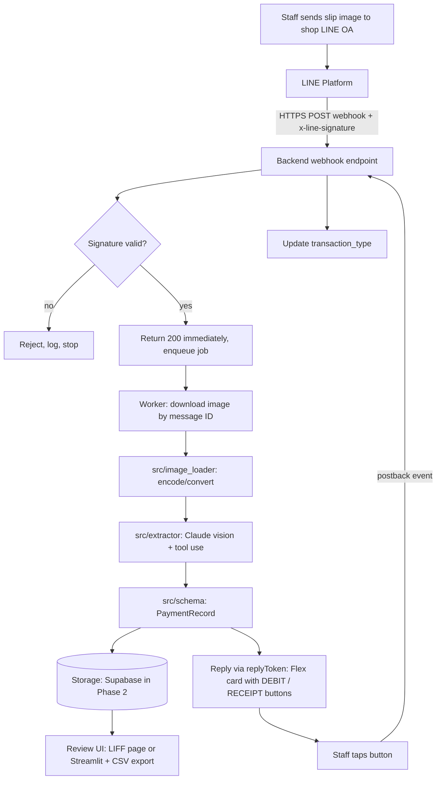

# LINE Official Account integration: research and plan

Status: research only, written 2026-11-08. **Not legal advice.** No code was written. Facts are cited to the sources in section 8. Anything marked **UNVERIFIED** could not be confirmed from a primary source during this research and must be checked before relying on it. Many legal sources used here are law-firm or vendor summaries, not statute text.

---

## 1. TL;DR verdict

**Technically possible: yes.** A shop's LINE Official Account (OA) with the Messaging API enabled can POST a webhook to a backend you host whenever someone sends an image. The backend verifies the signature, downloads the image by message ID, runs the existing `src/` extraction, and replies in chat. Nothing in LINE's docs forbids this flow, and nothing found says an OA cannot be used by a human and a bot at once (with one setting caveat, section 3.3).

**Blockers found: none absolute. Four things need a decision or a lawyer before real shop data flows:**

1. **LINE User Data Policy storage limit.** It says Friend and Group information may not be kept beyond 24 hours, and other LINE User Information must be disclosed to users if stored more than 24 hours. A persistent `userId/groupId -> shop_id` table could collide with this. Whether `userId`/`groupId`/image content is "LINE User Information" under that policy is **UNVERIFIED**. Needs confirmation from LINE or a lawyer.
2. **PDPA.** Slips contain third-party (payer) personal data. Thailand's PDPA applies; you would likely be a data processor for the shop (controller), which needs a written data-processing agreement, and sending images to Anthropic (US) is a cross-border transfer needing a safeguard mechanism. See section 5.
3. **Architecture shift.** The webhook cannot live in Streamlit. You need a small always-on HTTPS backend. That is new work, but `src/` is already reusable.
4. **LINE image retention is limited** ("automatically deleted after a period of time", length **UNVERIFIED**), so the backend must download immediately. It also means LINE is not your archive.

For a small, known set of named shops (the current CLAUDE.md scope), this looks feasible with a signed DPA, a privacy notice, and a retention policy. Opening it as a paid multi-shop SaaS raises the compliance bar (section 6).

---

## 2. How it would work

### 2.1 Step-by-step flow (happy path)

1. Staff add the shop's OA as a friend (or invite it into a staff LINE group). They send a slip screenshot to the OA chat.
2. LINE sends an HTTPS POST (webhook) to your backend URL with a `message` event of type `image`, containing `message.id`, `replyToken`, and `source` (`userId`, plus `groupId`/`roomId` for group chats). [src: receiving-messages, overview]
3. Backend reads the **raw** request body and `x-line-signature` header, computes HMAC-SHA256 of the body with the channel secret, base64-encodes it, and compares. Mismatch or missing header: reject and do nothing. [src: verify-signature]
4. Backend returns `200` quickly and processes asynchronously (LINE recommends async processing so later webhooks don't wait on the current one). [src: receiving-messages]
5. Worker downloads the image with the message ID through the Get content endpoint (channel access token required). Exact endpoint URL and retention window: **UNVERIFIED** (the pages fetched only said content is deleted "after a period of time"; the reference page text for Get content could not be retrieved).
6. Worker calls the existing pipeline: HEIC/format handling (LINE-delivered images are normally JPEG; format and compression **UNVERIFIED**) -> `encode_image` -> `extract_from_image` -> `PaymentRecord`.
7. Worker stores the record (Phase 2: Supabase) with `shop_id` resolved from the LINE source (section 3.3).
8. Worker replies: a Flex Message or quick-reply card showing the extracted amount/date/payer plus buttons **DEBIT / RECEIPT / Needs review**. Replies use the `replyToken`; reply messages are not counted against the plan's message quota. [src: pricing]
9. Staff tap a button. LINE sends a `postback` event; backend sets `transaction_type` on the record.
10. Owner opens a review page (LIFF inside LINE, or the existing Streamlit app) to check low-confidence rows and export CSV.

### 2.2 Flowchart

---

## 3. Architecture and components

### 3.1 What stays in `src/`, what is new

| Piece | Where | Notes |
|---|---|---|
| `image_loader`, `extractor`, `schema`, `token_tracker` | `src/` (existing) | Called unchanged. `src/` takes plain args and returns values, which is why a webhook worker can call it. Needs one small input option: accept image bytes + MIME type, not only a file path (a design note, not code now). |
| `storage.py` | `src/` | Phase 2: Supabase implementation behind the same function boundary. |
| Webhook server (new) | new top-level package, e.g. `line_bot/` | FastAPI or Flask app: signature check, event routing (`message`/`image`, `postback`, `follow`, `join`), reply/push client. Must not live inside `src/` (CLAUDE.md: `src/` has no UI/CLI/transport concerns). |
| Job queue / background worker (new) | `line_bot/` | Respond 200 fast, do download + Claude call after. Simple options: FastAPI background tasks (PoC), a queue later. |
| Mapping table (new) | DB | `line_source -> shop_id` (section 3.3). |
| Review UI | Streamlit (existing) and/or LIFF | Streamlit stays for the owner dashboard; LIFF is optional (section 3.4). |

### 3.2 Hosting

Streamlit Community Cloud runs only the Streamlit script, so it cannot serve a webhook. You need a separate always-on HTTPS service with a certificate from a widely trusted CA; LINE rejects self-signed certificates. [src: building-bot] Any small container host works (Cloud Run, Fly.io, Render, a small VPS). Choice of region affects PDPA cross-border analysis (section 5). Hosting vendor selection is not researched here.

### 3.3 Mapping LINE concepts to the schema

| LINE concept | Maps to | Comment |
|---|---|---|
| Messaging API **channel** (one per OA) | candidate `shop_id` | Cleanest if each shop has its own OA and its own channel: `shop_id` = the channel/OA id. Requires holding each shop's channel secret and access token (high-value secrets; store encrypted). |
| `source.userId` | staff member | Per-provider ID, not the phone number. Can call Get profile for display name (more personal data; avoid unless needed). |
| `source.groupId` / `roomId` | a shop's staff group | Bot receives message, unsend and postback events in groups and rooms. [src: receiving-messages] The group is a natural "shop inbox". |
| Shared single OA owned by you (SaaS) | needs a **binding step** | Staff send a one-time join code from the owner's dashboard; backend stores `userId/groupId -> shop_id`. Be careful: this table is the thing most likely to touch the 24-hour rule (section 1, item 1). |
| `message.id` | idempotency / audit | Store it so redelivered webhooks don't double-process. Use `webhookEventId` for dedupe too (redelivery is optional and can duplicate or reorder). [src: receiving-messages] |
| Image message | `source_filename` | Synthesize, e.g. from message ID. |
| Postback button | `transaction_type` | Postback data carries `record_id + DEBIT|RECEIPT`. |

Group or room chats and 1:1 chats both deliver message events; Follow/Unfollow are 1:1 only; Join/Leave/Member-join are group only. [src: receiving-messages]

**Coexisting with manual chat in LINE Official Account Manager.** LINE's guidelines say Webhooks enabled with Response mode on or off are both allowed; Webhooks disabled together with Response mode/Greeting disabled is not. [src: development-guidelines] Several vendor guides say Response mode must be **Bot** (switching to Chat-only turns the webhook off) and Chat can stay on so humans can still reply from the app. I found **no official LINE page confirming "Chat on + Bot mode"** (UNVERIFIED, check in OA Manager on a test account). Turn off Greeting and Auto-response messages so they don't collide with the bot. [src: building-bot; vendor: dmchamp, firstline]

### 3.4 Review UI and auth

- **LIFF** (LINE Front-end Framework) runs a web app inside LINE and can read the user's LINE user ID without a separate login prompt. A LIFF app must be added to a **LINE Login channel**. [src: liff-overview] This could host a mobile-friendly review page. Token verification details (ID token vs access token) were not retrievable: **UNVERIFIED**, read the LIFF/LINE Login docs when building.
- Keep the Streamlit app and its `[app_credentials]` gate for the PoC. Moving to LIFF/LINE Login is a Phase 3 item, and is a natural fit with the Supabase Auth plan.
- **Rich menu**: a persistent menu at the bottom of the chat (e.g. "Open ledger", "How to use"). Listed as a Messaging API feature. [src: overview]
- **Flex Messages / quick reply / postback**: Flex and template messages are supported message types; postback events are delivered in 1:1, group and room chats. [src: overview, receiving-messages]

### 3.5 Reply token vs push, cost

- **Reply** (using `replyToken`): not counted toward the plan's message count. **Push/multicast/broadcast/narrowcast**: counted per recipient. [src: pricing]
- Design rule: always answer with a reply message to the triggering event. Avoid push except for later notifications (e.g. a daily summary). Reply token lifetime is not stated on the pages fetched: **UNVERIFIED** (so reply within the async job quickly, and fall back to push on failure if the quota allows).
- Plan tiers in Thailand: LINE's own page only links out; third-party guides report Free (0 THB, about 300 broadcast messages/month), Basic (about 1,280 THB/month, 15,000 messages), Pro (about 1,780 THB/month, 35,000 messages), before 7% VAT. Sources conflict and are not official, so treat as **UNVERIFIED** and check the LINE Thailand pricing page. [src: linebot.pro, suriya.ai, syncedge] For an ingest-only bot that mostly replies, the free tier is plausibly enough, but confirm quotas.
- Rate limits and per-channel limits: **UNVERIFIED** (the pages fetched did not list them).
- Webhooks can be suspended by LINE if your server fails to receive them for a long time. [src: receiving-messages] Expect to monitor uptime.

### 3.6 LINE Notify

LINE Notify ended on 31 March 2025; LINE recommends the Messaging API instead. [src: LINE Notify notices] Do not plan anything on Notify.

---

## 4. Setup checklist

Accounts and channels
- [ ] LINE Official Account for the shop (or one for you if using the shared-OA model). Blue "verified" badge is optional (a third party quotes about 888 THB one-time, UNVERIFIED).
- [ ] LINE Developers Console login, create a **Provider** (one per company/product) and a **Messaging API channel** linked to the OA.
- [ ] In the channel: set **Webhook URL** (HTTPS), press Verify, turn on **Use webhook**. [src: building-bot]
- [ ] In OA Manager: Response mode = Bot (and test Chat on), disable Greeting and Auto-response messages. [src: building-bot, development-guidelines]
- [ ] Optional: enable webhook redelivery in the channel's Messaging API tab; then dedupe with `webhookEventId`. [src: receiving-messages]
- [ ] Optional later: a **LINE Login** channel + LIFF app for the review page.

Secrets (all server-side, never in the repo)
- [ ] `LINE_CHANNEL_SECRET` (signature verification; Basic settings tab, needs Admin).
- [ ] `LINE_CHANNEL_ACCESS_TOKEN` (recommend v2.1 token with expiry; long-lived tokens can be IP-restricted). [src: building-bot]
- [ ] `ANTHROPIC_API_KEY` (existing).
- [ ] Supabase URL and service key (Phase 2).
- [ ] If multi-shop with per-shop channels: encrypted per-shop secret store.

Compliance prerequisites (before real shop data)
- [ ] Written agreement with the shop (roles, purposes, retention, deletion on exit).
- [ ] Privacy notice text shown in the OA greeting / first message.
- [ ] Anthropic zero-data-retention decision (section 5).
- [ ] Choose Supabase and backend hosting regions.

Test
- [ ] Use a separate verification OA to test settings first (LINE recommends testing webhook changes on a verification account). [src: development-guidelines]
- [ ] Test with fake or redacted slips only.

---

## 5. Legal and compliance

Reminder: research summary, not legal advice. Many links below are law-firm or vendor commentary; statute text was mostly not retrieved. Thai statutes should be read in the official Thai text.

| Topic | What the rule says | Impact on us | Action |
|---|---|---|---|
| **PDPA applicability and personal data** (Personal Data Protection Act B.E. 2562) | Applies to controllers/processors handling personal data of individuals. A name, bank, and partial account number plus amount and date relate to an identifiable person. Sensitive data (Section 26) covers categories such as health, religion, biometrics; the exact list was not retrieved. [PDPA summaries: Lorenz, Nishimura] | Payer name + masked account + amount is personal data. Financial data is not on the Section 26 list as far as the summaries show (UNVERIFIED, list not fully retrieved), but a slip could incidentally reveal sensitive details through a free-text memo field. | Treat all slip data as personal data. Confirm with lawyer whether memo text risk needs handling (e.g. do not extract memo). |
| **Controller vs processor** | Controller decides purposes and means; processor acts on the controller's instructions and has its own duties (Section 40: records, security). A processor that goes beyond instructions is treated as controller for that processing. [src: Lorenz, search summaries] | Shop is controller of its payers' data; you are likely a processor while you only extract and store for that shop. If you reuse data (e.g. to train, analyse across shops), you become a controller. | Write a DPA/processing agreement. No cross-shop reuse of data. Decide the role with a lawyer. |
| **Lawful basis and consent** | Collection needs consent or another lawful basis (contract, legitimate interest, legal obligation). [Nishimura: consent or exception] | Payers never consented to a bookkeeping app seeing their slip. Shop's basis is likely legal obligation (bookkeeping) or legitimate interest; the payer sent/was shown the slip in the context of the transaction. | Lawyer to confirm basis and whether a payer notice is needed. Shop's privacy notice should mention bookkeeping tools. |
| **Notice and data-subject rights** | Data subjects have access, correction, deletion, objection rights; controllers must respond. [src: Lorenz] | Need ability to find and delete a record by payer/reference. | Build delete-by-record and an export; document the process. |
| **Cross-border transfer** (Sections 28/29, PDPC notifications Dec 2023) | Transfers need an adequate destination or safeguards. No country whitelisted as of the sources found; SCCs (ASEAN MCCs, EU SCCs, or PDPC-prescribed) are accepted without PDPC approval; BCRs need approval. [src: Linklaters, HSF Kramer, Clyde & Co; whether it already took effect, sources vary, UNVERIFIED] | Images go to Anthropic's API (US location UNVERIFIED), through LINE (processing location UNVERIFIED), and to Supabase (region TBD). Each is a transfer or onward processor. | Get Anthropic's DPA/SCCs, choose a nearby Supabase region (Singapore likely), record transfers in the agreement. Ask lawyer which mechanism fits. |
| **Breach notification** | Notify the PDPC without delay and within 72 hours of becoming aware, unless no risk to individuals; if late, within 15 days at the latest; fines up to THB 3m under Section 83. [src: DLA Piper] | A leaked slip database or leaked LINE token is notifiable. Processors must tell the controller. | Write an incident procedure; contract duty to tell shops promptly. |
| **Security measures** (Section 37) | Controller must have appropriate security measures to prevent unauthorised loss, access, use, alteration or disclosure. [src: PDPA summaries] | Webhook signature check, encrypted secrets, access control, encrypted storage, no full account numbers (already a project rule). | Implement and document. |
| **Record of processing (ROPA)** | Controllers and processors keep records; PDPC 2022 notification exempts small businesses (SME definition) except where processing risks individuals' rights or is regular. Residual duty to log rejected requests. A 2024 draft would amend it; final status UNVERIFIED. [src: Forvis Mazars, HSF Kramer, Chambers] | A SaaS handling many shops' data regularly probably cannot rely on the exemption. | Keep a simple ROPA anyway. Lawyer to confirm. |
| **DPO** (Section 41) | DPO required where processing involves regular monitoring on a large scale or core activity with sensitive data; PDPC notification of 13 Dec 2023 sets criteria. Full threshold text not retrieved. [src: DLA Piper] | Probably not triggered at a handful of shops; may be as it grows. | Re-check at each scale gate. |
| **Retention** | Keep personal data only as long as necessary for purpose. [PDPA summaries] | Conflicts with accounting-retention rules if you delete too early; conflicts with minimisation if you keep images forever. | Define: keep structured record per accounting rules; decide separately if the image is kept (see tax row). |
| **Bank secrecy / BoT rules** | Financial Institutions Business Act s.154 and BOT Act confidentiality target officials and persons performing duties under those laws, with listed exceptions. No source found applying them to private third parties holding a customer's own slip. [src: FIBA text via NACC, BOT Act] | Appears not to bind a bookkeeping tool that receives slips from its own users; no BoT rule on slips found. | UNVERIFIED conclusion. Ask lawyer to confirm no licence is needed. Do not store full account numbers or credentials; do not connect to bank APIs in this phase. |
| **Tax and accounting records** | Accounting Act: advisory firms say records and supporting documents kept at least 5 years from the last entry; Revenue Department may extend to 7 years during an investigation. Electronic records accepted if reproducible and backed up (secondary sources only, statute and Revenue Code s.87 not retrieved). e-Tax Invoice/e-Receipt regime concerns VAT-registered parties issuing digital documents. [src: Acclime, Forvis Mazars, GentleLaw] | A slip is supporting evidence, not itself a tax invoice. Whether the image must be kept, versus the data, and whether a LINE-forwarded screenshot is an acceptable record: UNVERIFIED. | Ask accountant/lawyer whether images must be retained. Until answered, keep images (not only the CSV) in your own storage for at least the retention period, which also helps because LINE deletes its copy. |
| **Electronic Transactions Act** | Governs legal validity of electronic documents and signatures; ETA amendments from 2019 relate e.g. to stamp duty on e-documents. [src: International Tax Review] | A screenshot is an electronic record; its evidentiary and integrity needs (hash, timestamp, immutable original) are relevant if disputed. UNVERIFIED in detail. | Keep original bytes and a hash; ask lawyer about evidentiary standard. |
| **LINE User Data Policy** | Must protect data; notify users of what is collected and get consent; Friend and Group information may not be kept beyond 24 hours; other LINE User Information stored more than 24 hours must be disclosed to users; disclosure to third parties only if required by law or to contractors for contracted work, bound by same terms; honor deletion requests; report security incidents; no use for other purposes; no selling. [src: LINE User Data Policy] | `userId`/`groupId` mapping may count as Friend/Group info (UNVERIFIED). Anthropic would be a contractor/sub-processor, which is allowed only to the extent needed and with equal obligations. Image content classification under the policy UNVERIFIED. | Ask LINE (developer support) in writing; design so the mapping can be re-derived from a join code rather than stored indefinitely if required. Bind Anthropic via DPA. |
| **LINE Developers Agreement** | Data from APIs retrieved only with user's explicit consent and not used outside the application; app must store sensitive info securely and report unauthorised access to affected users; developer responsible for content it handles; LINE may limit API request rates. [src: LINE Developers Agreement] | Staff must be told that slips they send are processed and stored. Payers are not LINE users of our app, which is fine, but their data is inside staff-submitted images. | Staff consent/notice in the OA greeting; read the current agreement fully (the version seen may be dated). |
| **LINE OA API terms (EN/TH)** | Customer treats information obtained through service as confidential, uses it only as needed for the service, and does not disclose to anyone other than operator. Page appears old. [src: LINE OA API Terms] | Possible friction with disclosing to a third-party AI. | UNVERIFIED current version. Ask lawyer/LINE. |
| **Anthropic data handling** | API: Anthropic docs state retained data is not used for training without express permission; default retention described as 30 days in the privacy centre; zero data retention (ZDR) available by arrangement per organisation; ZDR has exceptions (e.g. Files API, caching, some features) and some newer models require 30-day retention and are not available under ZDR. [src: Anthropic docs, privacy centre] | Images with payer details sit at Anthropic up to 30 days by default. Choice of model may affect ZDR eligibility. Anthropic's Commercial Terms and DPA not read in this research. | Request ZDR if the chosen model qualifies; read the DPA and region/sub-processor list; do not use the Files API if ZDR matters. |
| **Third-party data: payers** | Payers' names and partial accounts are in the image but they are neither shop users nor LINE users in this flow. PDPA still applies to their data. | They cannot give consent in practice; they exercise rights via the shop. | Data minimisation: extract only the fields in `PaymentRecord`; no memo field; no full account numbers; hide or avoid showing payer data in LINE reply cards in group chats (anyone in the group sees the card). |
| **Monetisation / digital platform rules** | Royal Decree on Digital Platform Services B.E. 2565 (effective Aug 2023): platform operators notify ETDA; foreign operators serving Thai users (Thai-language content, THB payment) can be deemed operating in Thailand and must appoint a contact person. Scope is intermediary platforms; a pure SaaS may be out of scope but not verified. [src: DSB, OneAsia, LawPlus] | If paid SaaS, check applicability. DBD e-commerce registration and VAT on SaaS were not researched. | UNVERIFIED. Lawyer to confirm; also consumer-protection, invoicing/VAT, and ToS for B2B. |

---

## 6. Risks and open questions

### Technical risks
- **Image fidelity**: LINE may recompress screenshots; Thai text on small slips could degrade extraction accuracy (compression details UNVERIFIED). Measure accuracy on LINE-delivered images before promising anything.
- **Webhook reliability**: LINE can suspend webhooks if your server is down for long; redelivery can duplicate and reorder events. Idempotency by `message.id` and `webhookEventId` required.
- **Cost surprises**: push messages and quota overage. Use replies only.
- **Group chats are public to members**: Flex cards show payer data to everyone in the group.
- **Secrets**: per-shop channel secrets in a database are a high-value target.
- **Duplicate slips**: still a Phase 2 item (CLAUDE.md); LINE makes accidental re-sends more likely.
- **Fraud**: fake slips are common in Thai retail. This tool extracts what an image says; it does not verify the transfer happened. Say so in the product; bank-API slip verification is out of scope and its legal position was not researched.

### Questions for a Thai lawyer / DPO
1. Are we a data processor for each shop, a controller, or joint controllers? What must the processing agreement contain?
2. What is the shop's lawful basis for sending payer slips to us, and do payers need a notice?
3. Does sending images to Anthropic (US) need SCCs or another mechanism today? Which instrument and what record must we keep? Is the cross-border notification already in force?
4. Do we need to appoint a DPO or keep a ROPA at our size, or when we reach N shops?
5. Does the LINE User Data Policy "24 hours" rule apply to `userId`, `groupId` and image content? Does our DB mapping breach it, and can LINE grant an exception?
6. Are there limits in the LINE OA/Developers terms on passing message content to third-party AI services?
7. Does any Thai financial or bank-secrecy rule (FIBA, BoT rules, payment-system rules) restrict a non-bank handling a customer's own slip? Any licence needed?
8. Must we retain original slip images for the Accounting Act / Revenue Code period, or is the structured ledger enough? Is a screenshot via LINE an acceptable supporting document, and under the Electronic Transactions Act what integrity measures are expected?
9. If we charge subscriptions: ETDA digital platform notification, DBD registration, VAT, consumer-protection or B2B terms?
10. What breach-notification duties apply to us as a processor, and what contract timeline should we promise shops?

---

## 7. Phased rollout plan (no code)

**Phase 0: Decisions (no shop data).**
- Pick the account model: one OA per shop (shop owns the OA, you hold its channel secret/token) vs one shared OA with a join-code binding. Recommendation for first pilot: **one OA, one shop (Jason's own or a friendly shop)**, so no mapping table and no multi-tenant secrets.
- Answer: gate to continue = lawyer's first-pass answers on questions 1, 3, 5, 8 (or a documented decision to accept the risk for a single-shop pilot with own data).
- Gate: LINE pricing/quota confirmed on the official Thailand page; OA Manager Chat+Bot setting tested on a verification account.

**Phase 1: Single-shop pilot, fake slips.**
- Stand up the backend with signature verification, async worker, reuse `src/` extraction, reply with a text summary only.
- Download image immediately, store it in your own bucket.
- Gate: accuracy on LINE-delivered images is acceptable versus direct uploads; duplicate and redelivery handling proven; no secrets in logs; Anthropic ZDR/DPA decision made.

**Phase 2: Classification and review.**
- Flex/quick-reply DEBIT/RECEIPT via postback; Supabase storage; Streamlit review reads from Supabase; CSV export.
- Privacy notice in the OA greeting; delete-by-record process; retention job.
- Gate: incident and deletion procedures written; DPA signed with the pilot shop; ROPA drafted.

**Phase 3: A few named shops.**
- Binding/join-code flow or per-shop channels; encrypted secret store; `shop_id` enforced in all queries (Supabase row-level security).
- Optional LIFF review page with LINE Login.
- Gate: lawyer sign-off on multi-shop role split, cross-border mechanism, and LINE terms position; written LINE answer on the 24-hour rule.

**Phase 4: Paid product.**
- Billing, ToS, VAT, ETDA/DBD analysis, DPO assessment, support and uptime commitments.
- Gate: all open legal questions closed in writing.

---

## 8. Sources

LINE (official)
- Messaging API overview: https://developers.line.biz/en/docs/messaging-api/overview/
- Receiving messages (webhooks): https://developers.line.biz/en/docs/messaging-api/receiving-messages/
- Verify webhook signature: https://developers.line.biz/en/docs/messaging-api/verify-webhook-signature/
- Building a bot: https://developers.line.biz/en/docs/messaging-api/building-bot/
- Messaging API pricing (Japan example, reply vs push): https://developers.line.biz/en/docs/messaging-api/pricing/
- Development guidelines (webhook/response mode combinations): https://developers.line.biz/en/docs/partner-docs/development-guidelines/
- Messaging API reference index (Get content etc.): https://developers.line.biz/en/reference/messaging-api/
- LIFF overview: https://developers.line.biz/en/docs/liff/overview/
- LINE User Data Policy: https://terms2.line.me/LINE_Developers_user_data_policy
- LINE Developers Agreement: https://terms2.line.me/LINE_Developers_Agreement
- LINE Official Account API Terms (EN/TH): https://terms2.line.me/official_account_api_terms_th
- LINE terms index: https://developers.line.biz/en/terms-and-policies/

LINE (third-party, not official)
- Thailand plan pricing (conflicting, UNVERIFIED): https://linebot.pro/blog/line-official-account-pricing-guide , https://suriya.ai/blog/line-oa-what-is-pricing-thailand , https://syncedge.tech/en/guides/line-oa-systems/
- Chat + Bot mode vendor guides: https://help.dmchamp.com/messaging-channels/line/ , https://en.help.firstline.cc/feature/channels/line , https://support.zendesk.com/hc/en-us/articles/4408826465690-LINE-integration-stops-receiving-messages
- LINE Notify shutdown (31 Mar 2025): https://roboin.io/article/2024/10/07/line-terminates-line-notify-service , https://github.com/louislam/uptime-kuma/issues/5527

Thai law and regulation (secondary)
- Cross-border rules: https://www.linklaters.com/en/insights/blogs/digilinks/2024/january/thailand---new-rules-for-transborder-dataflow , https://www.hsfkramer.com/notes/data/2024-01/thailands-new-legislation-on-cross-border-transfer-of-personal-data , https://www.clydeco.com/en/insights/2024/01/thailand-personal-data-protection-regulation-notif
- Breach notification and DPO: https://privacymatters.dlapiper.com/2025/02/thailand-pdpcs-clarification-on-personal-data-breach-notification/ , https://www.dlapiperdataprotection.com/index.html?t=breach-notification&c=TH
- PDPA overview and subordinate laws: https://www.lorenz-partners.com/wp-content/uploads/2020/03/NL224E-Thailand-Personal-Data-Protection-Act-Mar20.pdf , https://www.nishimura.com/en/knowledge/publications/consent-or-exception-which-way-is-better-under-the-thai-personal-data-protection-act , https://www.dfdl.com/insights/legal-and-tax-updates/thailands-personal-data-protection-act-pdpa-subordinate-laws/
- ROPA SME exemption: https://www.forvismazars.com/th/en/insights/doing-business-in-thailand/legal/small-enterprises-exempt-from-preparing-records , https://www.hsfkramer.com/it/notes/data/2025-posts/exemption-for-smes-on-preparation-of-records-of-processing-activities-under-thai-privacy-laws , https://chambers.com/articles/thailand-personal-data-protection-act-exception-for-smes-to-record-of-processing-activities-ropa
- Financial Institutions Business Act: https://www.nacc.go.th/abas/upload/files/2018/03/b73410d4bce9b16a30e2fd1d427bda8c.pdf ; BOT Act: https://www.bot.or.th/content/dam/bot/documents/en/laws-and-rules/laws-and-regulations/legal-department/1-bot-act/1.1%20LAW01_BOTAct.pdf
- Accounting/e-records: https://thailand.acclime.com/guides/accounting-introduction/ , https://www.forvismazars.com/th/en/insights/doing-business-in-thailand/tax/e-tax-filing-and-documentation-in-thailand , https://www.gentlelawibl.com/post/e-tax-invoice-and-e-receipt-thailand-2026-systems-legal-requirements-easy-e-receipt-2-0-and-an-s
- Electronic Transactions Act / e-document stamp duty: https://internationaltaxreview.com/article/2a6a41udxe4e2ku4ik074/thailand-issues-regulation-on-stamp-duty-payment-for-electronic-documents
- Digital Platform Services decree: https://dsb.co.th/thailand-royal-decree-on-digital-platform-b-e-2565-2022/ , https://oneasia.legal/en/5583 , https://www.lawplusltd.com/2024/04/digital-platform-services/

Anthropic
- API and data retention: https://platform.claude.com/docs/en/manage-claude/api-and-data-retention
- Zero data retention scope: https://privacy.claude.com/en/articles/8956058-i-have-a-zero-data-retention-agreement-with-anthropic-what-products-does-it-apply-to

### Not verified (summary list)
LINE Get-content endpoint URL and the image retention period; reply token lifetime; image format/compression delivered by LINE; Messaging API rate limits; Thailand plan prices and quotas (official page); official confirmation of Chat+Bot coexistence; whether LINE user/group IDs and image content fall under the 24-hour rule; LINE Official Account API Terms current text; whether the Thai cross-border notifications are in force as described; DPO thresholds; ROPA exemption current status; Accounting Act and Revenue Code retention text and whether images must be kept; bank-secrecy applicability to third parties; DBD/e-commerce registration and SaaS scope under the platform decree; Anthropic Commercial Terms/DPA, data location, and ZDR eligibility for the chosen model.
